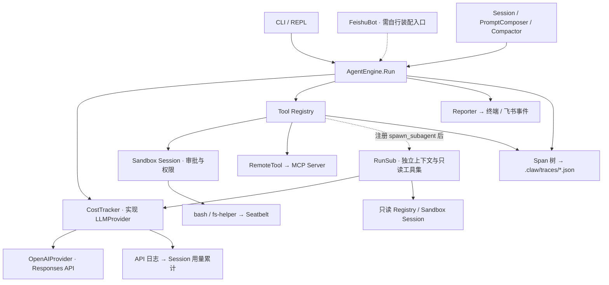

# my-tiny-claw

一个用 Go 实现的开发 Agent，围绕统一模型访问、工具执行、子 Agent 探索、上下文管理和运行度量构建。

项目把模型协议、Agent 循环、工具、输出渠道和执行权限拆成独立模块。默认 CLI 已接入持续对话、OpenAI Responses API、文件工具、后台 Bash、远程 MCP、Token/费用估算和本地链路追踪；子 Agent 与飞书适配器提供代码级扩展入口。

> 受限沙箱目前主要支持 macOS，依赖系统 Seatbelt。Linux/Windows 的受限权限档会拒绝执行。

## 目录

- [特性与启用状态](#特性与启用状态)
- [快速开始](#快速开始)
- [CLI 命令](#cli-命令)
- [整体架构与功能模块](#整体架构与功能模块)
- [权限与审批](#权限与审批)
- [配置](#配置)
- [MCP 配置](#mcp-配置)
- [沙箱命令](#沙箱命令)
- [测试与验收](#测试与验收)
- [已知边界](#已知边界)
- [目录结构](#目录结构)

## 特性与启用状态

| 能力 | 实现内容 | 默认 CLI 状态 |
| --- | --- | --- |
| 统一模型访问 | `LLMProvider.Generate` 隔离模型协议；统一消息、工具定义、调用结果和 Usage | 已接入 OpenAI Responses Provider，可配置兼容服务和模型 |
| Agent 编排 | 模型调用、同轮工具并发、结果回流；可选独立 Thinking 阶段 | 已启用 Action 循环；独立 Thinking 默认关闭 |
| 上下文与技能 | 会话历史、工作记忆、工具输出压缩、`AGENTS.md`、技能按需加载 | 已启用；PlanMode 引导模型维护 `PLAN.md` / `TODO.md` |
| 子 Agent | 独立探索上下文、只读工具注册表、最多 10 轮、返回摘要 | 核心已实现；默认 CLI 尚未注册 `spawn_subagent` |
| 可观测与度量 | 分层 Span、工具事件、API 耗时、Token 消耗、会话费用估算 | 已接入 CostTracker、TerminalReporter 和本地 JSON Trace |
| 文件与命令 | 文件读写、模糊编辑、Bash 前台/后台任务、日志游标和进程清理 | 已启用 |
| 沙箱与审批 | 权限档、Seatbelt、fs-helper、显式提权、会话批准缓存 | macOS 默认 `:workspace` + `on-request` |
| 网络控制 | HTTP / HTTPS CONNECT / SOCKS5，域名规则、批准后 DNS、代理端口隔离 | 使用 `proxy` 权限档时启用；默认网络关闭 |
| MCP 扩展 | 远程工具发现、HTTP 传输、Header 环境变量、OAuth | 有 `~/.claw/mcp.json` 时加载 |
| 输出渠道 | `Reporter` 接口统一思考、工具、结果和回复事件 | CLI 已接入；飞书 Bot/Reporter 已实现，需自行装配服务入口 |

## 快速开始

### 环境要求

- macOS
- Go 1.26.2 或更高版本
- 一个 OpenAI Responses API 兼容服务
- macOS `/usr/bin/sandbox-exec`
- 可选：Git、ripgrep、Node.js/npm、Python/pip

### 配置模型服务

```bash
git clone https://github.com/aka-xubo/my-tiny-claw.git
cd my-tiny-claw

export CODEX_API_KEY='你的 API Key'
export CODEX_BASE_URL='https://coding.gaiaworks.net/openai/v1'  # 可选
export CODEX_MODEL='gpt-6.1-sol'                                # 可选
```

模型配置读取顺序如下：

| 配置 | 环境变量 / 默认值 |
| --- | --- |
| API Key | `CODEX_API_KEY`，必填 |
| API 根地址 | `CODEX_BASE_URL` → `OPENAI_BASE_URL` → `https://coding.gaiaworks.net/openai/v1` |
| 模型 | `CODEX_MODEL` → `gpt-6.1-sol` |

Base URL 填 API 根路径，程序会追加 `/responses`。首次构建时 Go 会下载依赖。

### 启动对话式 CLI

```bash
go run ./cmd/claw -dir .
```

启动后输入自然语言任务：

```text
claw> 帮我运行测试并总结失败原因
```

### 单次运行

```bash
go run ./cmd/claw \
  -prompt '运行测试并总结结果' \
  -dir .
```

单次模式没有交互式审批入口，需要审批的调用会被拒绝。

## CLI 命令

```text
/permissions              查看权限档
/permissions :workspace   切换权限档
/approval on-request      设置审批策略
/approval untrusted       所有命令和文件写入默认询问
/approval never           需要审批的操作直接拒绝
/approve                  查看后台待处理审批
/approve 1 y              允许一次
/approve 1 a              本会话允许
/approve 1 n              拒绝
/approve 1 r 原因          拒绝并记录原因
/exit                     退出 CLI
```

在 Agent 回合运行时按 Ctrl-C 会取消当前回合；在输入提示符处按 Ctrl-C 或 Ctrl-D 会退出 CLI。

## 整体架构与功能模块



主循环在模型没有继续请求工具时结束；工具结果通过调用 ID 关联回模型，供下一轮读取和纠错。代码级模块链接见下文；在主 CLI 中，模型请求经过 CostTracker，工具执行经过 Registry，两处分别记录用量与执行事件。

### 统一模型访问

[`LLMProvider`](internal/provider/provider.go) 定义统一入口：

```go
type LLMProvider interface {
    Generate(
        ctx context.Context,
        messages []schema.Message,
        availableTools []schema.ToolDefinition,
    ) (*schema.Message, error)
}
```

Engine 依赖该接口，消息、工具定义、工具调用与 Usage 使用 [`internal/schema`](internal/schema/message.go) 的公共结构。当前具体实现 [`OpenAIProvider`](internal/provider/openai.go) 负责：

- 将会话转换成 Responses API 输入。
- 将工具 JSON Schema 转成 function tools。
- 使用 `call_id` 关联工具调用和结果。
- 把回复文本、function calls、输入/输出 Token 统一返回。
- 保留 API 状态码、错误类型等诊断信息。

切换兼容模型服务可以配置地址和模型名；接入其他协议需要实现 `LLMProvider`。目前仓库只有 OpenAI Responses 这一个 Provider 实现，没有多服务商自动路由或故障切换。

`CostTracker` 同样实现这个接口，以装饰器方式包裹真实 Provider：

```text
AgentEngine → LLMProvider（CostTracker）→ OpenAIProvider → Responses API
```

### Agent Engine 与上下文管理

[`AgentEngine`](internal/engine/loop.go) 把一次任务组织为反复执行的模型与工具循环：

1. `PromptComposer` 组合基础指令、工作区 `AGENTS.md`、沙箱信息和技能元数据。
2. `Session` 提取近期工作记忆，`Compactor` 在超出长度阈值时折叠早期输出、截断较近的大块内容，保留系统指令和工具调用结构。
3. 通过 `LLMProvider` 获取文本与工具调用；同轮工具可并发执行。
4. 工具结果写回会话，失败时由 `RecoveryManager` 注入针对性恢复建议。
5. `ReminderInjector` 根据工具名与参数指纹检测重复失败，达到阈值后提醒模型改变策略或请求人工帮助。

默认 CLI 使用 `PlanMode=true`、`EnableThinking=false`。PlanMode 在提示词中要求模型维护 `PLAN.md` 和 `TODO.md`；独立 Thinking 阶段是引擎提供的可选额外模型调用，当前没有 CLI 开关。

会话历史与 Token/费用累计保存在进程内存中。`-session` 用来标识会话，当前没有将聊天历史保存到磁盘并在重启后恢复的实现；计划文件和 Trace 文件是独立的磁盘产物。

技能放在 `<workspace>/.claw/skills/**/SKILL.md`。启动时只注入名称与描述，模型通过 `read_skill` 读取正文；加载技能的同一轮，其他执行工具会延后到下一轮。

### 子 Agent 探索

[`SubagentTool`](internal/tools/subagent.go) 通过 `AgentRunner` 接口调用 `AgentEngine.RunSub`，用于跨文件检索、阅读代码和整理线索：

```text
主 Agent 调用 spawn_subagent(task_prompt)
  → RunSub 创建独立消息历史
  → 仅暴露传入的只读 Registry
  → 模型读取和搜索，最多 10 轮
  → 返回探索摘要，主 Agent 继续任务
```

子 Agent 复用所属 Engine 的 Provider，直接进入 Action 循环，不额外执行 Thinking 阶段；使用同一个 CostTracker 时，其模型调用也会计入该 Tracker 绑定的会话。探索过程通过 Reporter 以 `[Subagent]` 标记输出，完整探索历史保留在子循环里，主上下文接收最终摘要。

这里的上下文隔离发生在同一 Go 进程中；操作系统权限限制由只读工具及其 Sandbox Session 实现。只读注册表应包含 `read_file`、只读 bash、`read_skill`，采用 `:read-only`、`never` 和 `DenyApprover`。

**当前默认 CLI 尚未注册此工具，也没有启用它的命令行参数。** 嵌入式使用时，通过 `NewSubagentTool(runner, readOnlyRegistry, reporter)` 注册到主 Registry。`cmd/claw/main.go` 的 `testSubAgent` 辅助函数展示了相关装配组件，当前不是 CLI 子命令。

### 工具、后台任务与 MCP

[`Registry`](internal/tools/registry.go) 以 `BaseTool` 接口统一内置工具和远程工具，负责 Schema 暴露、中间件、调用路由、结果封装及工具级 Trace。

| 工具 | 作用 | 默认 CLI |
| --- | --- | --- |
| `read_file` | 读取权限档允许的文件 | 已注册 |
| `write_file` | 创建或覆盖文件 | 已注册 |
| `edit_file` | 使用模糊替换编辑文件 | 已注册 |
| `bash` | 执行一次性或后台命令 | 已注册 |
| `read_skill` | 按需读取技能正文 | 已注册 |
| `spawn_subagent` | 启动只读探索子 Agent | 需要装配注册 |
| `mcp__<server>__<tool>` | 调用远程 MCP 工具 | 随 MCP 配置加载 |

[`TaskManager`](internal/tools/task_manager.go) 按会话 owner 和工作区管理后台进程，提供运行状态、退出码、信号、日志游标及有界输出缓冲。短命令在等待窗口内返回结果；长命令返回 `session_id`，模型可以继续调用：

```json
{"action":"poll","session_id":"<id>"}
{"action":"list"}
{"action":"stop","session_id":"<id>"}
```

`RemoteTool` 将 MCP 工具适配成 `BaseTool`，模型与引擎不需要为每个 MCP Server 单独实现调用分支。

### 可观测与度量

[`internal/observability`](internal/observability) 提供本地链路追踪与模型用量记录，输出渠道通过 [`Reporter`](internal/engine/reporter.go) 解耦。

| 组件 | 记录内容 | 输出位置 |
| --- | --- | --- |
| `Span` | 名称、开始/结束时间、毫秒耗时、属性、父子关系 | `<workspace>/.claw/traces/trace_<session>_<timestamp>.json` |
| `CostTracker` | 模型请求耗时、输入/输出 Token、费用估算、请求失败或缺失 Usage | 标准日志；Token/费用累计到 Session |
| `TerminalReporter` | 工具调用、截断后的参数、工具成功/失败、Agent 回复 | 终端 |
| `FeishuReporter` | 相同 Reporter 事件 | 飞书消息，需要自行装配 Bot 入口 |

主循环导出的 Trace 树包含如下节点：

```text
Agent.Run
  └─ Turn-N
       ├─ LLM.Thinking    # 仅启用独立 Thinking 时出现
       ├─ LLM.Action
       └─ Tool.Execute
```

CLI 还会创建 `CLI.TaskRun` 或 `CLI.REPLTurn` Span；每次 `Agent.Run` 结束时导出执行树，单次 CLI 结束时也会导出 CLI 根 Span。属性包括会话与工作区、上下文消息数量、工具名、工具参数和输出预览等，具体内容随调用入口变化。

查看本地 Trace：

```bash
ls -lt .claw/traces/
python3 -m json.tool ".claw/traces/替换为实际的Trace文件名.json"
```

这里是本地 JSON 记录，没有接入 OpenTelemetry、Prometheus 或独立监控面板。Token 由模型 API 的 Usage 提供；调用失败或没有 Usage 时不估算 Token。

费用目前按 `PricingModel` 的硬编码示例价格计算，CLI 传给 Tracker 的计价模型名固定为 `gpt-6.1-sol`，不会随 `CODEX_MODEL` 自动同步；字段和日志中的币种标签也尚未统一。因此费用只能用作开发参考，不能当作服务商实际账单或正式计费依据。单次 CLI 结束时打印汇总；REPL 通过每次模型调用的 Tracker 日志显示累计值。

MCP 工具通过 `TraceRedactor` 避免把参数和输出写入 Trace，但终端 Reporter、普通日志和其他工具参数并没有全局脱敏。Trace 与日志可能包含工作内容，分享前应检查内容。Trace 当前按秒命名，同一会话同秒的多次导出可能覆盖；它不是持久化聊天记录或完整审计日志。

### Sandbox Session

`internal/sandbox` 是本地执行的统一入口，主要组件如下：

- `profile.go`：权限档和内置权限。
- `config.go`：TOML 配置、继承、项目可信和环境变量策略。
- `seatbelt.go`：生成参数化 SBPL 和权限规则。
- `sandbox_darwin.go`：组装 `sandbox-exec`。
- `policy.go`：审批策略、缓存、额外权限和代理端口组。
- `terminal_approver.go`：终端审批和后台编号审批。
- `proxy/`：HTTP、CONNECT、SOCKS5 代理和域名规则。

### 文件工具与 fs-helper

主进程不直接访问模型指定的目标文件。文件工具先调用 `Authorize`，再启动隐藏子命令：

```text
claw 主进程
  └─ sandbox-exec ... claw __fs-helper
       └─ 处理一个 JSON 请求并退出
```

helper 支持 `read`、`write` 和 `edit`。写入优先使用临时文件、`fsync` 和原子替换；目录不可写但目标文件可写时，才尝试原地写入。已有多硬链接文件会拒绝原地回退。

### MCP Client

`internal/mcpclient` 在启动时读取远程 MCP 配置，发现的工具注册到同一个 Tool Registry。当前只支持 HTTP 传输，不支持本地 stdio Server。

## 权限与审批

### 内置权限档

| 权限档 | 文件 | 网络 |
| --- | --- | --- |
| `:read-only` | 全盘读取，不允许写入 | 禁止 |
| `:workspace` | 全盘读取；工作区和临时目录可写；`.git`、`.claw`、`.agents`、`.aws` 只读 | 禁止 |
| `:danger-full-access` | 当前用户完整权限 | 直连 |

默认权限档是 `:workspace`，默认审批策略是 `on-request`。

模型需要扩大权限时，工具参数必须显式声明：

```json
{
  "command": "git commit -m 'fix'",
  "sandbox_permissions": "with_additional_permissions",
  "justification": "提交修改需要写入 .git",
  "additional_permissions": {
    "filesystem": {
      ".git": "write"
    }
  }
}
```

完全绕过沙箱需要：

```json
{
  "sandbox_permissions": "require_escalated",
  "justification": "需要完全访问的明确原因"
}
```

沙箱初始化、规则生成或平台支持检查失败时，程序拒绝执行，不会退回到无沙箱执行。

## 配置

### 用户级和项目级配置

用户配置：

```text
~/.claw/config.toml
```

项目配置：

```text
<workspace>/.claw/config.toml
```

项目配置需要交互确认信任后才会加载。非交互模式会忽略未信任的项目配置。

示例：

```toml
default_permissions = "dev"
approval_policy = "on-request"

[permissions.dev]
description = "日常开发"
extends = ":workspace"

[permissions.dev.filesystem]
"~/Library/Caches/go-build" = "write"

[permissions.dev.filesystem.":workspace_roots"]
"**/*.env" = "deny"

[permissions.dev.network]
mode = "proxy"

[permissions.dev.network.domains]
"proxy.golang.org" = "allow"
"sum.golang.org" = "allow"
"*.github.com" = "allow"

[shell_environment]
exclude = ["MY_PRIVATE_*"]
keep = []
```

网络模式：

- `disabled`：禁止网络。
- `proxy`：只允许连接当前权限档对应的本地 HTTP/SOCKS5 代理。
- `full`：允许直连网络。

## MCP 配置

MCP 配置文件：

```text
~/.claw/mcp.json
```

可复制示例：

```bash
mkdir -p ~/.claw
cp mcp.example.json ~/.claw/mcp.json
```

示例配置：

```json
{
  "servers": {
    "github": {
      "transport": "streamable-http",
      "url": "https://example.com/mcp",
      "headers": {
        "Authorization": "Bearer ${MCP_GITHUB_TOKEN}"
      },
      "tools": ["create_issue", "list_issues"]
    }
  }
}
```

支持：

- `streamable-http`
- `stateless-http`
- Header 中的 `${ENV_NAME}` 展开
- OAuth 授权码流程和 `~/.claw/mcp-oauth.json` 凭据保存

暂不支持本地 stdio、旧 SSE、MCP Resources、Prompts、Sampling、Elicitation、Roots 和 Session 失效后的自动重建。

## 沙箱命令

查看权限档生成的 Seatbelt 策略：

```bash
go run ./cmd/claw sandbox \
  -permissions :workspace \
  --print-policy
```

在权限档中执行命令：

```bash
go run ./cmd/claw sandbox \
  -permissions :workspace \
  -- /bin/bash -c 'echo hello'
```

`__fs-helper` 是文件工具使用的内部子命令，不建议手动调用。

## 测试与验收

普通测试：

```bash
go test ./...
```

格式化、静态检查和竞态检测：

```bash
gofmt -w cmd internal
go vet ./...
go test -race ./...
```

在真实 macOS Seatbelt 环境中进行严格验收：

```bash
CLAW_REQUIRE_SEATBELT=1 \
CLAW_REQUIRE_TOOLCHAINS=1 \
go test ./... -count=1 -v
```

严格验收会覆盖：

- bash 和 fs-helper 的真实文件攻击矩阵。
- 符号链接、glob、保护目录和敏感文件。
- TCP、UDP、Unix socket、HTTP、HTTPS CONNECT 和 SOCKS5。
- 审批矩阵、缓存、REPL、Ctrl-C 和后台任务。
- Git、rg、Node、Python、npm、pip 和 Go 测试。

本地完整测试矩阵和证据保存在 `docs/plans/2026-11-24-sandbox-acceptance.md`。`docs/plans/` 和 `design/` 已被 Git 忽略，新克隆的仓库可能不含这些本地材料。

## 已知边界

- 当前模型访问仅实现 OpenAI Responses 协议；其他协议需要新的 Provider。
- 子 Agent 和飞书组件已实现，默认 CLI 未启用其入口；飞书既有审批组件也没有接入本次沙箱 Approver。
- 会话历史和用量累计仅在进程内存中，`-session` 不提供跨进程聊天恢复。
- 当前沙箱后端只实现 macOS；Linux/Windows 的受限权限档会 fail closed。
- 默认权限档允许宽泛读取，读取内容可能进入模型上下文。
- 主 Agent 进程和远程 MCP 调用本身不在这套本地沙箱内。
- 已预先存在的硬链接可能被 Bash 原地写入时写穿；文件工具的原子写会保护外部原件，多硬链接原地回退会拒绝。
- 代理端口组按网络规则隔离，但代理只能展示候选来源，不能精确认证每一次连接属于哪个进程。
- `sandbox-exec` 已被 Apple 标记为废弃，但当前 macOS 实现仍依赖它。

## 目录结构

```text
cmd/claw/              CLI 入口、REPL 和 sandbox 子命令
internal/engine/       Agent 回合循环、工具调用和子 Agent
internal/context/      会话、提示词、技能和上下文压缩
internal/provider/     统一 LLMProvider 接口与 OpenAI Responses 适配
internal/tools/        内置工具、后台任务和工具注册表
internal/sandbox/      权限档、Seatbelt、审批、代理和配置
internal/fshelper/     沙箱内文件操作 helper
internal/fsops/        文件编辑和替换逻辑
internal/mcpclient/    远程 MCP 客户端
internal/feishu/       Bot、Reporter 与既有审批组件，入口需自行装配
internal/schema/       消息和工具 schema
internal/observability/ 分层 Span、Token 度量与成本估算
```

## License

项目当前未在仓库中声明许可证。使用和分发前请先确认项目维护者的许可范围。
